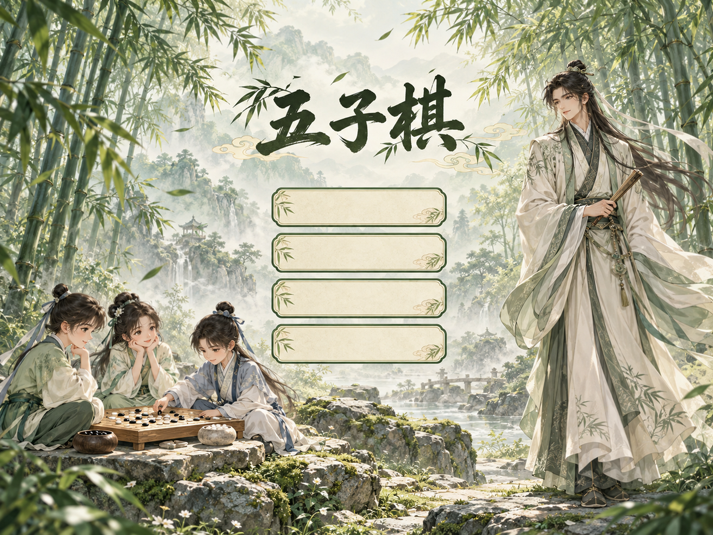

# 五子棋游戏 · C++ / EGE

面向软件工程实训的 Windows 五子棋项目，包含 **Gomoku2、Gomoku3 两个版本**、完整游戏素材和两套源码学习资料。支持本地双人、人机对弈、双人联网，以及残局保存和棋谱复盘。

> 上图为随项目提供的菜单素材，并非本次运行截图。本仓库整理保留原始实现，未在本次整理中重新验收游戏全部交互。

## 快速开始

1. 点击仓库 **Code → Download ZIP** 并完整解压，或使用 Git 克隆。
2. 进入 `Gomoku3`，运行 `Gomoku.exe`。请保留同目录的 `assets` 和 `GomokuServer.exe`。
3. 点击“开始游戏”，选择单机、人机或联网对弈。程序面向 64 位 Windows，窗口为 1800×1350。

## 两个版本怎么选

| 版本 | 代码组织 | 建议用途 |
|---|---|---|
| [Gomoku2](Gomoku2/) | 入口较短，绘图、输入、动作和共享界面状态拆分到多个头文件 | 对照模块关系，逐步学习事件处理 |
| [Gomoku3](Gomoku3/) | 入口文件集中组织主界面和流程，规则、AI、网络、存储仍独立 | 顺着主流程阅读并运行体验 |

两个版本的主要功能有重叠；版本号不代表所有功能都存在严格的包含关系，具体以各自代码为准。

## 文档导航

- [使用说明](docs/使用说明.md)：启动、对弈、存档、复盘和联网。
- [开发工具与构建](docs/开发工具与构建.md)：Dev-C++、EGE、编译参数及编码要求。
- [项目介绍](docs/项目介绍.md)：功能、版本和目录说明。
- [设计思想与流程](docs/设计思想与流程.md)：模块职责、操作流程和联网设计。
- [学习资料导航](docs/学习资料导航.md)：两套 output 的打开方式。
- [原始工程实现方案](五子棋工程实现方案.md)：历史设计，含尚未落地的规划。
- [素材与整理说明](docs/素材与整理说明.md)：素材、原文件保留及上传取舍。

## 主要功能与范围

- 15×15 棋盘，黑先白后，五子及以上连线获胜，无禁手规则。
- 本地双人；三档人机，支持选择执棋颜色。
- 单机/人机残局保存、继续游戏；棋谱单步及自动复盘。
- TCP 双人房间，准备、落子同步、协商悔棋和重开、认输及本机复盘保存。
- 动画菜单、中文界面和棋盘交互。

当前不提供公共匹配、账号系统、断线重连、联网残局续玩、多局赛制或 30 秒自动代落子。原始方案中的此类条目属于规划。

## 学习入口

- Gomoku2：完整下载后双击 `output/g2/index.html`，查看模块、调用和变量关系。
- Gomoku3：完整下载后双击 `output/g3/游戏全链路/Gomoku3_全游戏交互链路图.html`；也可阅读 `output/g3/pdf/Gomoku3_源码阅读伴侣.pdf`。

GitHub 文件预览不会直接运行这些交互 HTML，请下载后用浏览器打开。图中的静态关系和源码快照仅用于学习，修改代码后需重新核对。

## 开发说明

C++11 + EGE + Windows API / Winsock，原工程使用 Dev-C++ 5.11、TDM-GCC 4.9.2 64 位。原源码含 GBK 编码，请勿批量转换为 UTF-8。运行游戏无需 Python 或 PowerShell；从源码构建需要相应编译环境。

现有版本 README 中提及的 `tests/` 脚本未随本次提供的源目录出现，不能据此声称仓库含有自动测试或已通过这些检查。

## 授权

本仓库暂未添加开源许可证；代码与素材的具体授权范围尚未统一确认。公开可见不等于获得任意复用或再分发授权。
