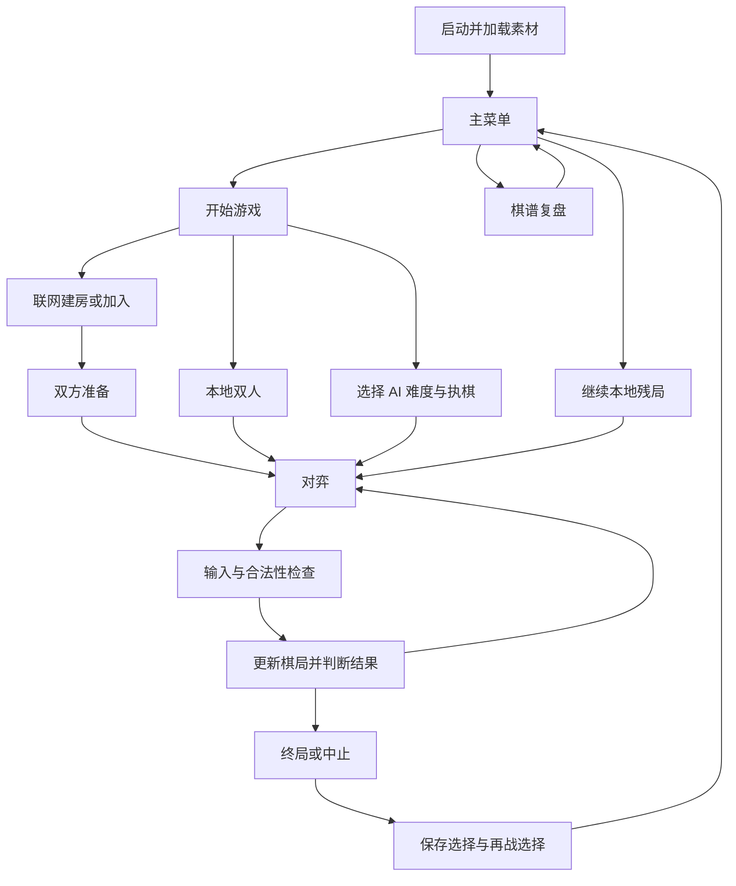

# 设计思想与流程

本文依据现有目录、源码引入关系及版本说明整理。历史总体设计保留在根目录；若规划与当前实现冲突，以代码和对应版本说明为准。

## 模块分工

| 模块 | 责任 |
|---|---|
| game_logic.h | 棋盘、轮次、合法落子与胜负规则 |
| ai_engine.h | 候选点、棋型评估、搜索和后台任务 |
| record_store.h | 存档/复盘读取、验证与写入 |
| replay_logic.h | 复盘游标、单步和自动播放 |
| network_protocol.h | 网络消息、房间状态与快照验证 |
| network_transport.h | TCP 长度分帧、后台收发与队列 |
| server_main.cpp | 双人服务端和权威裁决 |
| online_ui.h | 建房、加入、准备、协商和保存界面 |
| match_metadata.h | 结束原因、结果和时间元信息 |

Gomoku2 另将界面共享状态、绘图、动作和输入拆开；Gomoku3 在 main.cpp 集中组织更多界面代码。规则与传输分离，使本地、人机和联网能够复用基础棋局逻辑。

## 主流程

## AI

各档先检查一步成五和必要防守，常规候选聚焦已有棋子附近。简单档采用攻防评分及近优随机；一般、困难档采用 Negamax、Alpha-Beta 和迭代加深，较高难度增加搜索预算和深度上限。后台线程返回结果后仍需确认任务有效，防止悔棋或重开后旧结果落入新棋盘。深度上限不保证每次都能完成，实际受局面和电脑速度影响。

## 联网

客户端发出操作请求 → 服务端校验局号、步数、轮次与询问状态 → 广播确认状态 → 双方更新显示。TCP 使用长度前缀分帧，网络线程处理收发，EGE 主线程负责界面。询问、保存和再战通过阶段同步避免一方提前开始下一局。

房主执黑、加入者执白。联网悔棋与重开需要协商；退出和断线保留明确原因。复盘各自在本机保存，联网未完记录不恢复续局。

## 存储和边界

通过落子历史重建并检查棋局，拒绝越界、重复、轮次错误或结果矛盾等数据。存档用于继续本地未完棋局，复盘用于只读回放。当前缺少断线重连、多局制和计时自动代落子，不能仅凭历史方案推断已实现。
